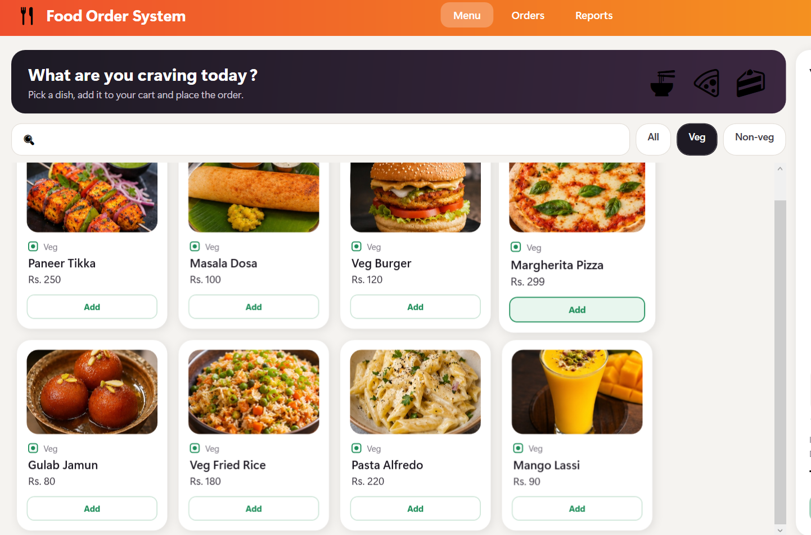
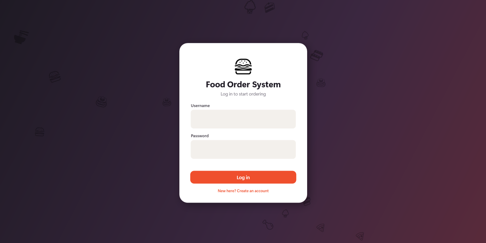

# Food Order System
   

A layered C# application for ordering food: browse a menu, build a cart, apply coupons, place orders, and see sales reports. It runs as a console app and as a WPF desktop app on top of the same business logic.




## Features

- Veg and non-veg menu with search and filters (WPF)
- Cart with quantity controls and coupon codes: `SAVE10`, `FLAT50`, `BIG100`
- Order placement with status tracking (Placed, Preparing, Delivered)
- Sales reports: total revenue, best sellers, revenue per day (LINQ)
- Local login and sign up with salted, hashed passwords (WPF)
- Orders saved to a SQLite database through EF Core
- Optional dish photos: put `1.jpg`, `2.jpg`, and so on in `FoodOrder.Wpf/Images` (the number is the dish id)

## Architecture

| Project | What it holds |
|---|---|
| `FoodOrder.Domain` | Models (`MenuItem`, `Cart`, `Order`), `OrderStatus`, interfaces (`IDiscount`, `IRepository<T>`), custom exceptions |
| `FoodOrder.Services` | `OrderService` (place orders, apply discounts) and `ReportService` (LINQ reports) |
| `FoodOrder.Data` | `JsonRepository<T>` and `EfOrderRepository` (EF Core + SQLite) |
| `FoodOrder.App` | Console menu |
| `FoodOrder.Wpf` | WPF desktop interface |
| `FoodOrder.Tests` | xUnit tests |

## Design decisions

- **Code depends on interfaces, not classes.** `OrderService` asks for an `IRepository<Order>` through its constructor, and dependency injection decides which implementation it gets.
- **Storage was swapped without touching the services.** The app first saved orders to a JSON file. Moving to EF Core and SQLite meant writing one new repository class and changing one registration line.
- **Discounts use the strategy pattern.** `PercentageDiscount`, `FlatDiscount` and `ThresholdDiscount` all implement `IDiscount`, so new coupon types need no changes to existing code.
- **Tests use a fake repository.** `OrderService` is tested against an in-memory repository, so tests never touch a database file.

## Testing

```
dotnet test FoodOrder.Tests
```

8 tests cover each discount (including boundary cases), cart totals, order status rules, empty-cart handling, and order placement with a discount.

## How to run

Requires the .NET SDK (the projects target .NET 10). The WPF app needs Windows.

```
dotnet build
dotnet run --project FoodOrder.App    # console
dotnet run --project FoodOrder.Wpf    # desktop UI
```

The SQLite database (`order.db`) is created in the folder you run from.

## Known limitations

- Login is local only, and orders are not linked to a user yet
- Order status can't be advanced from the UI
- No web API yet

## Roadmap

- [ ] Make repository and service methods async
- [ ] ASP.NET Core Web API with Swagger
- [ ] JWT login and per-user orders
- [ ] GitHub Actions to build and test on every push
- [ ] SQL Server support and a Dockerfile