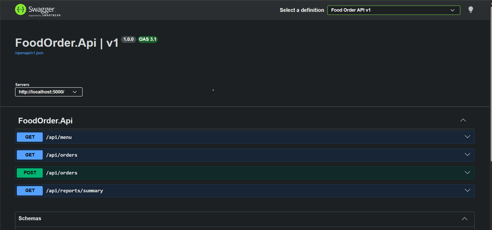

# Food Order System


A layered C# application for ordering food: browse a menu, build a cart, apply coupons, place orders, and see sales reports. The same business logic runs behind a console app, a WPF desktop app, and a containerized ASP.NET Core API.




## Features

- One-click Demo / Guest Mode for instant evaluator walkthrough without registration
- User authentication with PBKDF2 salted, hashed passwords (WPF & API)
- Veg and non-veg menu with search and filters (WPF)
- Cart with quantity controls and coupon codes: `SAVE10`, `FLAT50`, `BIG100`
- Order placement linked to the authenticated user with status tracking (Placed, Preparing, Delivered)
- Personal spending and sales reports (LINQ)
- Dual database support: SQLite for local dev/desktop, and Microsoft SQL Server for production
- Asynchronous database operations using EF Core (`async`/`await`)
- REST API with OpenAPI documentation, Swagger UI, and JWT Bearer authentication
- Multi-stage Docker containerization and Docker Compose orchestration
- Optional dish photos: put `1.jpg`, `2.jpg`, etc. in `FoodOrder.Wpf/Images` (the number is the dish id)

## Architecture

| Project | What it holds |
|---|---|
| `FoodOrder.Domain` | Core models (`MenuItem`, `Cart`, `Order`), `OrderStatus`, interfaces (`IDiscount`, `IRepository<T>`), custom exceptions |
| `FoodOrder.Services` | `OrderService`, `ReportService` (LINQ reports), `MenuCatalog` and `CouponCatalog` |
| `FoodOrder.Data` | `OrderDbContext`, `EfOrderRepository` (EF Core with SQLite and SQL Server support), `UserStore` |
| `FoodOrder.App` | Console menu interface |
| `FoodOrder.Wpf` | WPF desktop interface |
| `FoodOrder.Api` | ASP.NET Core minimal API with JWT authentication |
| `FoodOrder.Tests` | Unit tests (xUnit) |
| `FoodOrder.Api.Tests` | API integration tests (xUnit, `WebApplicationFactory`) |

## Design Decisions

- **Code depends on interfaces, not classes.** `OrderService` asks for an `IRepository<Order>` through its constructor, and dependency injection decides which implementation it gets.
- **Pluggable storage with EF Core.** The system supports both SQLite (for lightweight local development, tests, and WPF) and Microsoft SQL Server (for Docker and production) by switching configuration without altering domain or service logic.
- **Discounts use the strategy pattern.** `PercentageDiscount`, `FlatDiscount`, and `ThresholdDiscount` all implement `IDiscount`, so new coupon types need no changes to existing code.
- **Fully asynchronous I/O.** Database calls use `await`, ensuring the WPF desktop UI stays responsive without thread blocking, and the web API handles concurrent traffic efficiently.
- **Claims-based security.** The API validates JWT bearer tokens and extracts the user's identity from `ClaimsPrincipal`, ensuring strict multi-tenant order isolation and preventing IDOR vulnerabilities.
- **Isolated testing.** Unit tests and API tests use in-memory fakes, allowing the entire suite to run quickly in CI without external database dependencies.

## API Endpoints

Run the API:

```powershell
dotnet run --project FoodOrder.Api --urls http://localhost:5000
```

Open `http://localhost:5000/swagger` to explore the OpenAPI documentation.

| Method | Path | Description |
|---|---|---|
| POST | `/api/auth/register` | Register a new user |
| POST | `/api/auth/login` | Login and receive a JWT Bearer token |
| GET | `/api/menu` | List all menu items |
| GET | `/api/orders` | List past orders for the logged-in user (Auth required) |
| POST | `/api/orders` | Place a new order for the logged-in user (Auth required) |
| GET | `/api/reports/summary` | Order count, revenue, and top-selling items for the logged-in user (Auth required) |

Example request body for `POST /api/orders`:

```json
{ "itemIds": [1, 2], "coupon": "SAVE10" }
```

## Testing

Run unit tests and integration tests:

```powershell
dotnet test FoodOrder.Tests
dotnet test FoodOrder.Api.Tests
```

- **Unit tests** verify each discount strategy, cart calculations, order state transitions, and service error handling.
- **Integration tests** spin up the API in-memory using `WebApplicationFactory` to test registration, JWT authentication, order placement, and per-user order isolation.

GitHub Actions builds the solution and runs all tests on every push and pull request.

## How to Run

Requires the .NET SDK (.NET 10). The WPF app requires Windows.

### Running Locally
```powershell
dotnet build
dotnet run --project FoodOrder.Wpf    # Desktop GUI
dotnet run --project FoodOrder.Api    # Web API
dotnet run --project FoodOrder.App    # Console interface
```

### Running with Docker (API + SQL Server)
```powershell
docker compose up --build
```

## Known Limitations

- The repository and `OrderService` are registered as singletons with an in-memory counter for order IDs; a production multi-server setup would use a scoped `DbContext` with database-generated primary keys.
- Order status advancement is handled via domain methods but not yet exposed as an administrative button in the UI.